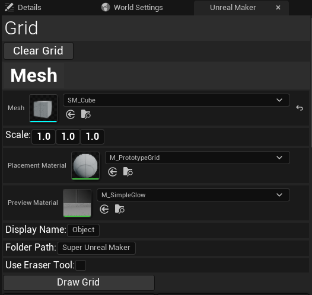
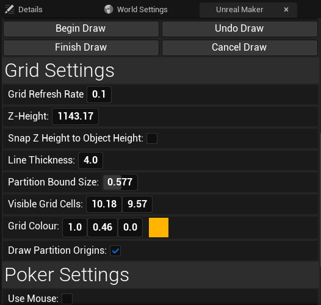
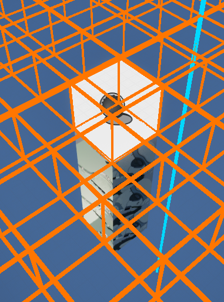

# Super Unreal Maker

## Full Breakdown Video

## About

Super Unreal Maker is a tool developed using Unreal Engine's Editor Utility Widgets in Unreal 5.6. It was made as a project for university.

The idea behind the module was to develop a tool that could be integrated anywhere in the development or design pipeline to speed up something that
we felt was inadequate about the engine or had room to be improved or streamlined. 
The concept behind this tool was to improve the level design workflow of unreal engine for geometric level design and arcade-style games
by introducing a grid based editor that allows users to choose a mesh, configure the grid and the mesh to their needs and then paint instances of the mesh
into a level. The project was heavily inspired by Super Mario Maker but adapted into Unreal and designed for 3D levels.

## [Download the project off the repository.](https://github.com/The-Ondeveloper/ToolDev-UnrealMaker)

## [View the Technical Design Document here.](https://staffsuniversity-my.sharepoint.com/:w:/g/personal/s013512o_student_staffs_ac_uk/IQDj0HDHl62gSrl948ZFgaW3AUZdf3eDnUYbdzCCiDkqW5Q?e=qM5FOP) 

## Details of the User Interface

The Editor Utility Widget drives user interaction with the tools. 
It communicates with the classes in the tool using a service locater to run logic when buttons are pressed,
it also contains a plethora of settings for users to configure both the selected mesh their working with
and the appearance of the tool. 
Options included being able to adjust the tick rate of the grid (mentioned in a later section), 
whether the mouse or the centre of the screen is used to select grid cells and a host of cosmetic options; 
settings are written to Data Assets which means they can be saved between sessions of using the tool and 
changes are automatically read by the other classes within the tool.
I included as many settings as I could in the tool as I wanted users to be able to customise the workflow
and scale the performance of the tool to their needs.

The Grid section of the UI allows users to configure various setting about a mesh before its placed into the world, 
such as material and scale.
This is one of the core features of Super Unreal Maker as it allows you to easily paint and fit numerous meshes
with the same configuration without relying on duplication.

While the UI was designed in UMG instead of slate, it is designed to mimic the look of UE as closely as possible.
The reason why UMG was chosen instead of slate was to save development time and focus on producing a working prototype
as we had stict deadlines to work to on the course module; this is also why the tool was made in blueprint as opposed to C++.

## Implementation of the Grid system

### Grid Refresh Rate

The grid is rendered using Unreal Engine's Draw Debug Box function and is driven entirely by mathmatical logic. 
It simulates tick by running it's refresh function in a delayed loop 
(with the delay being the Grid Refresh Rate setting on the UI) as Unreal Engine doesn't allow tick in the editor viewport.
It uses a tick esque system to allow the grid to respond immediately to user inputs, such as changing the camera location or 
changing the tool settings, by redrawing the grid with the updated settings. The grid is designed so that the grid will only redraw
if any significant changes have actually been made since the last draw, if not it keeps the grid that has already been drawn.

### Partitioning system

On each update of the grid, it gets the location of the viewport camera to determine what 'partition' the player is currently in,
the grid only draws cells in the partition the viewport camera is currently in as well nearby neighbouring partitions.
The size of the partition is determined by the scale of the selected mesh multiplied by the number of visible grid cells per partition 
(Determined by the user). The first partition originates from X: 0, y: 0, z: (custom Z-height setting) and the location of every other partition (its origin)
is equal to the number partitions it as away from x: 0 y: 0 multiplied by the size of each partition. The partition the user is currently in 
is found by comparing the location of the last partition the user was in with their new position to determine the 
minimum number of partitions needed to check. It then iterates through each partition the camera could be in and checks if its within its boundaries.

Once the partition has been found, 
the grid finds the centre of each partition neighboring the current partition and determines if the viewport camera is close enough for 
the partition to be rendered. The user can set how close the camera has to be to the neighbour partition for it to be rendered with 
Partition Bound Size with 1 being always render neighboring partitions and 0 being never render them.

### Drawing the grid 

Once the grid knows what partitions to render, it takes the location of each partition and then draws a debug box for each cell in each partition.
The Draw Grid function is unaware of the partition size, but always draws the right number of cells because it knows the value of the 'visible grid cells' setting
and the size of each grid cell is determined by the scale of the selected mesh, which also determines the partition size.

### Design considerations

The grid uses mathmatically driven logic as opposed to a object-oriented logic, 
I chose this approach as the tool demands a lot of complicated operations and I wanted a lean approach that saves memory and works at scale.
With this approach nothing really exists internally, only a handful of variables need to be stored to do the calculations that render the grid to the user,
and any data about the grid that affects the tool's functionality (such as where to place the selected mesh in the level) can also be calculated using those variables when that information is needed.

An example where this approach benefitted the grid implementation is the partition system; the only partitions that exist in any meaninful way are the ones being currently rendered, 
and yet the tool knows where to draw partitions anywhere in the level without having to manually set up partition boundaries. 
This optimisation allows the size of the grid to be effectively infinite without having to draw cells that are irrelevant to the user or store them in memory,
and none of it requires manual set up.

## Drawing meshes onto the grid

### Behind the scenes

The grid class primarily only handles rendering a representation of the grid to the user, but the data it stores is also used by other classes to handle 
the real functionality of the tool. The cell poker class runs on a similar tick system and performs a line trace from the viewport camera (or the mouse position if enabled) 
to the grid, it then checks the location of each cell by first determining the location of the partition its in and the iterating through each grid until it 
finds the one the end of the trace is contained within. 
If a cell is found, the poker fires an event that tells the Object constructor class to create/move a preview of the selected mesh to the location of that grid cell.
The object constructor takes into account the origin point of the selected mesh and adds an offset to ensure the preview mesh is properly centered within the grid cell.

### The user-end drawing tools

The previously mentioned object constructor is a manager for all mesh previews in the level and can keep track of more than one. 
When the grid is active but no drawing tools are in use, it only uses one preview mesh which it moves to whatever grid cell the viewport is looking at.
If the user clicks 'Finish Draw' in this state, they'll be able to place a mesh at the location of the preview mesh, but only one at a time. If the user wants
to place meshes more rapidly they can click 'Begin Draw', this will tell the object constructor to create a new preview at every grid cell that gets collected.
The constructor keeps track of an array of every preview created, so when the user clicks 'Finish Draw' it can iterate through every preview mesh and convert it into a permanent
static mesh. The object constructor prevents creating preview meshes where one has already been placed for optimisations sake.

The user also has buttons to 'Cancel Draw' and 'Undo Draw', with 'Cancel Draw' deleting all preview meshes in the array without placing a static mesh, 
and 'Undo Draw' only deleting the last preview added to the array. The use of buttons was a design limitation caused by not being able to identify a way 
to add or override key commands in the unreal editor, which would've been useful for painting more intuitively.

## Design Limitations

While I am proud of what I was able to acheive with this project, I think the biggest issue with this project was that it was over scoped for a university module. 
Given further development time there are many features and optimisations I would've loved to improve, including a refactor into C++ and Slate, the ability to change mesh and grid rotation,
more supported types of actors (blueprints, decals, etc.), more intuitive controls, an eye drop tool and a lot more.

 

 